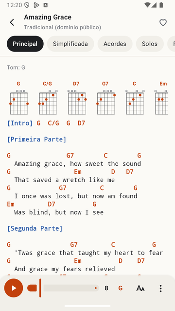
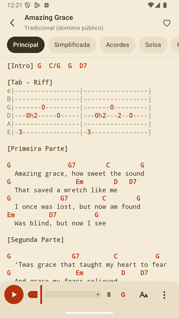
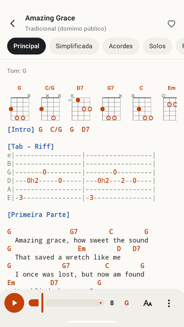
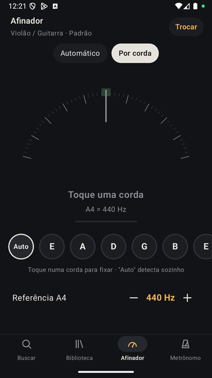
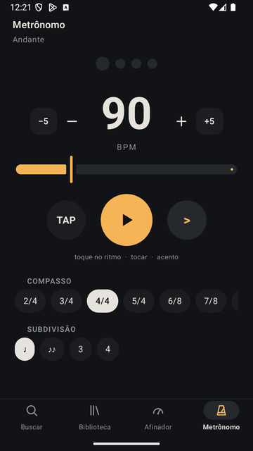
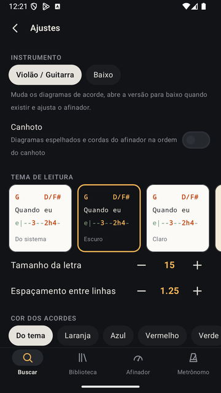

# Pestana

<p>
  <a href="https://github.com/batatinhafcbatatinha-pixel/pestana/actions/workflows/build.yml"></a>
  <a href="https://github.com/batatinhafcbatatinha-pixel/pestana/actions/workflows/codeql.yml"></a>
  <a href="https://scorecard.dev/viewer/?uri=github.com/batatinhafcbatatinha-pixel/pestana"></a>
  <a href="SECURITY.md#conferir-um-download"></a>
  <a href="LICENSE"></a>
</p>

Cifras, afinador e metrônomo num app nativo, leve e sem conta, para **Android, Mac e iPhone/iPad**.

<p align="center">
  
  
  
</p>
<p align="center">
  
  
  
</p>

## Baixar

Em [Releases](https://github.com/batatinhafcbatatinha-pixel/pestana/releases), cada versão traz todas as plataformas juntas:

- **Android:** `pestana-<versão>-android.apk`.
- **Mac:** `pestana-<versão>-mac.dmg`, universal (Apple silicon e Intel). O app não é notarizado pela Apple, então na primeira vez é preciso clicar com o botão direito › **Abrir**.
- **iPhone/iPad:** `pestana-<versão>-iphone.ipa`. Instale pelo [SideStore](https://sidestore.io) ou pelo [AltStore](https://altstore.io), que assinam o app com o seu Apple ID. Com um Apple ID gratuito a assinatura vale 7 dias, e o SideStore a renova sozinho.

O app de Mac e o de iPhone são gerados automaticamente pelo CI, mas **ainda não foram testados num aparelho**.

Todo arquivo de release tem um atestado assinado de proveniência. Para conferir: `gh attestation verify <arquivo> -R batatinhafcbatatinha-pixel/pestana`. O [SECURITY.md](SECURITY.md) explica isso em detalhe.

- **Rápido e pequeno:** no Android usa Kotlin + Jetpack Compose e, no Mac e no iPhone, SwiftUI. Os três usam o mesmo núcleo em Rust, por JNI e por ABI C. O APK tem cerca de 1,8 MB.
- **Instrumentos:** violão/guitarra ou baixo, à escolha em Ajustes ou dentro da cifra. Os diagramas viram caixas de baixo (tônica, quinta e oitava), a versão para baixo da cifra abre primeiro e o afinador muda junto. Há também modo **canhoto**.
- **Tudo local:** favoritos (músicas, artistas e álbuns), playlists, histórico e ajustes por música ficam num SQLite no aparelho. Não existe conta nem servidor.
- **Offline:** toda cifra aberta fica salva. Dá para baixar uma playlist inteira de uma vez para usar sem internet.
- **Ordenar e filtrar:** playlists, favoritas e álbuns podem ser ordenados (tocadas por último, lançamento, A–Z, artista, álbum) e filtrados por solo, riff, capotraste e afinação.
- **Página do artista:** as 15 músicas mais tocadas e a discografia completa.

## Leitura de cifras

- Os acordes ficam **sempre sobre a sílaba certa**. Numa tela estreita, a linha de acordes e a letra quebram juntas, na mesma coluna, e nunca no meio de um acorde. As tablaturas quebram em bloco, com as 6 cordas alinhadas.
- **Seções:** Principal, Simplificada, Solos, Riffs e as outras versões publicadas (Acústica, Versão 2, 3…). A aba Simplificada só aparece quando a música tem essa versão; para as outras, "Simplificar acordes" reduz os acordes a tríades.
- **Ajustes de leitura:** transposição com a grafia certa (♯/♭ conforme o tom), capotraste com formas equivalentes, simplificar acordes, mostrar ou ocultar tablaturas e diagramas.
- **Diagramas de acorde para qualquer acorde:** a tabela cobre os shapes abertos clássicos, e os demais saem de uma busca que pontua a tocabilidade (posição, pestana, cordas abafadas, baixo correto). Há modo canhoto.
- **Rolagem automática:** velocidade ajustável, lembrada por música.
- **Pedal Bluetooth:** Page Up/Down, setas e espaço viram a página. As teclas de volume também podem rolar (opcional).
- **Cores:** os acordes têm cor própria, e dá para escolher a cor dos acordes e a da letra. Nas tablaturas, os números e as técnicas (h, p, b, /, ~) ficam destacados das linhas.
- **Temas pensados para leitura:** Escuro, Claro, Sépia (Kindle), Papel (E-ink), Noturno (luz quente), Preto (AMOLED) e Alto contraste.
- A tela fica ligada enquanto a cifra está aberta. Playlists tocam em sequência, com botões de próxima e anterior.

## Afinador

- Usa o **McLeod Pitch Method** (NSDF com interpolação parabólica) em Rust, sobre a entrada de áudio *UNPROCESSED* quando o aparelho suporta (sem redução de ruído nem ganho automático), e um filtro mediano que descarta saltos de oitava. Nos testes com sinal sintético, o erro fica abaixo de 0,5 cent de 31 Hz a 988 Hz.
- **Modos:** automático (cromático), que mostra a nota que você toca, ou por corda (você escolhe a corda ou deixa o app detectar).
- **23 afinações:** baixo/violão/guitarra (padrão, meio tom e um tom abaixo, Drop D/C#/C/B, DADGAD, Open G/D/E/A/C, 7 cordas), baixo de 4 e 5 cordas, ukulele, cavaquinho e viola caipira.
- Referência A4 ajustável entre 415 e 466 Hz.

## Metrônomo

Tem precisão de amostra: os cliques são mixados no próprio fluxo de áudio, então o tempo não deriva. Inclui tap tempo, compassos de 2/4 a 12/8, subdivisões (colcheia, tercina e semicolcheia) e acento no primeiro tempo. Também dá para ligar o metrônomo de dentro da cifra.

## De onde vêm as cifras

A busca usa o endpoint público de busca da Cifra Club. O próprio celular abre a página da música como um navegador faria: primeiro tenta HTTP simples e, se não der, usa o WebView do sistema, bloqueando anúncios. O núcleo em Rust extrai o bloco `<pre>`, o tom, o capotraste, a afinação e os links de outras versões.

O parser não depende de classes CSS de um site específico, então funciona com outras páginas de cifra (opção **Importar › link**). Isso inclui o **Ultimate Guitar**, cuja cifra vem num JSON embutido na página. O **Songsterr** não é suportado: lá só existem tablaturas desenhadas a partir de partituras, sem cifra em texto. Também dá para **colar o texto** de qualquer cifra, ou **compartilhar** um link ou texto de outro app para o Pestana.

**Importar playlists da Cifra Club:** cole o link de uma playlist pública, ou do seu perfil para escolher várias, sem fazer login. O app cria playlists locais e, se você quiser, baixa todas as cifras para usar offline.

As cifras pertencem aos autores e aos sites de origem. O app só as exibe para uso pessoal.

## Estrutura

```
core/      Rust: chord.rs (acordes, transposição), sheet.rs (parser e layout),
           shapes.rs (diagramas de violão e baixo), pitch.rs (afinador), html.rs (extração),
           jni_api.rs (Android) e ffi.rs (ABI C para o Swift)
android/   App Kotlin + Compose
apple/     App SwiftUI para Mac e iPhone/iPad (projeto gerado com xcodegen no CI)
```

## Build

Requisitos: JDK 17+, Android SDK e NDK, Rust com `cargo-ndk`.

```sh
rustup target add aarch64-linux-android x86_64-linux-android
cargo install cargo-ndk
cd core && cargo test --release     # testes do núcleo
cd ../android && ./gradlew assembleRelease
```

O app Apple é gerado no macOS com `sh apple/build-core.sh && cd apple && xcodegen generate`, e depois é só abrir `Pestana.xcodeproj`.

O GitHub Actions compila tudo a cada push, e uma tag `v*` publica **um único release** com Android, Mac e iPhone.

## Licença

MIT
